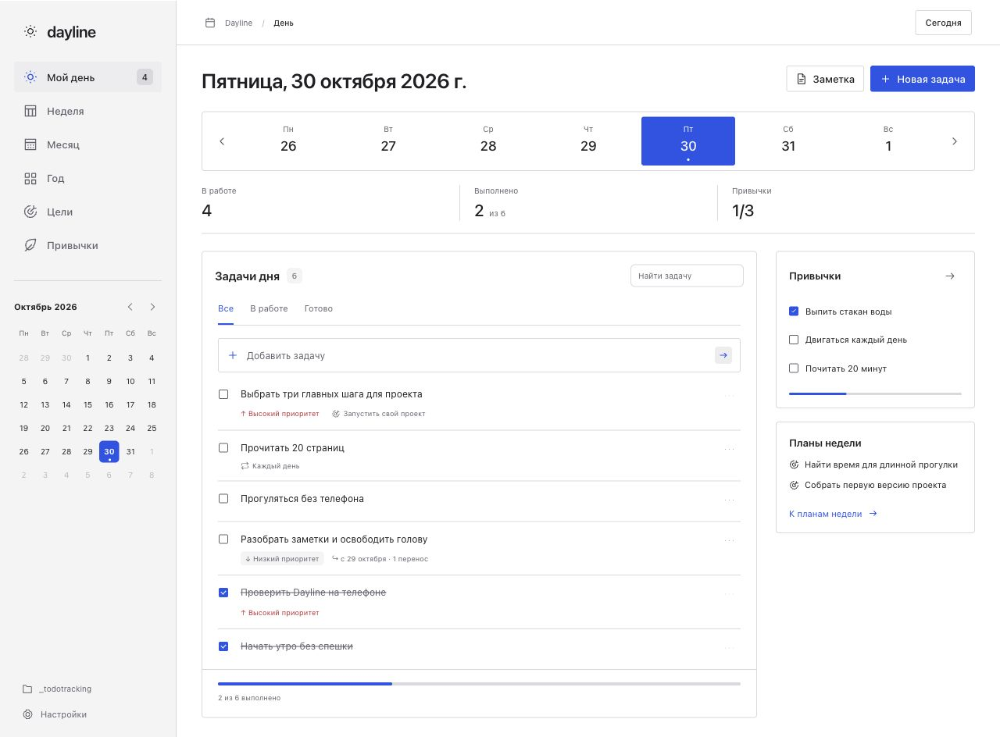

# Smart Todo для Obsidian

Личное пространство для задач, календаря, планов, целей и привычек. Интерфейс на русском, светлая и тёмная темы, адаптив для узких панелей и телефона. Без аккаунта, сервера, аналитики и внешних ресурсов.



## Идентификатор и совместимость

Название: **Smart Todo**. ID в каталоге Community plugins: **`smart-todos`**. Исходное рабочее имя `dayline` совпало с чужим плагином в каталоге Obsidian; этот ID больше не используется для установки или поиска обновлений.

Существующие файлы с `type: dayline-task`, `dayline-goal`, `dayline-habit` и маркером `<!-- dayline:task -->` по-прежнему читаются. Все новые файлы используют префикс `smart-todo`. Перезаписывать или переносить старые заметки при переименовании не требуется.

## Установка

В Obsidian откройте Settings → Community plugins → Browse, найдите **Smart Todo**, нажмите Install, затем Enable.

Готовый архив: `dist/smart-todo-1.0.7.zip`. Распакуйте папку `smart-todos` в `<ваше хранилище>/.obsidian/plugins/`, затем включите **Smart Todo** в настройках сторонних плагинов. При необходимости перезапустите Obsidian, чтобы он обнаружил плагин. Требуется Obsidian 1.8 или новее.

Из исходников (Node.js 22+):

```sh
npm ci
npm run check
npm run install-plugin -- --vault "/путь/к/хранилищу"
```

Установщик копирует только `main.js`, `manifest.json`, `styles.css`. Существующие версии этих файлов сохраняются в `dist/backups`. Настройки и пользовательские заметки он не меняет. Включение плагина выполняется в Obsidian.

Откройте Smart Todo по значку солнца на ленте или командой **Smart Todo: Открыть планировщик**. На телефоне добавьте эту команду в мобильную панель инструментов.

## Что умеет

- **День.** Недельная лента, календарь, быстрое добавление по Enter, кнопка `…` слева от ввода для полной формы создания с переносом введённого названия, приоритеты, сроки, поиск, фильтры, привязка к цели. Название задачи открывает форму редактирования; меню `…` позволяет перенести её, открыть Markdown, отменить или удалить. **Отмена** сохраняет файл и историю со статусом `cancelled`; восстановление доступно в Markdown: замените `[-]` на `[ ]`. **Удаление** убирает задачу из планировщика и перемещает её файл в папку `.trash` хранилища. Файл можно вернуть из корзины в исходную папку `tasks`.
- **Незавершённые без перезаписи.** В сегодняшнем плане доступны незавершённые задачи прошлых дней с подписью «В плане с …». Дата `scheduled` и история не меняются при наступлении нового дня, запуске или синхронизации. В текущей неделе, месяце и году также видны незавершённые задачи предыдущих периодов отдельной группой. В будущих и прошлых периодах показываются назначенные задачи и фактические выполнения; будущие дни не заполняются незавершёнными заранее. Недельные, месячные и годовые планы не появляются в дне без явного назначения. Дату можно изменить вручную; это действие сохраняется в истории. Старые даты и события автопереноса остаются без массовой миграции.
- **Неделя, месяц, год.** Можно создавать задачи любого горизонта и назначать им дату в форме редактирования. Обзоры показывают свои планы и задачи меньшего горизонта с датой в этом периоде. Недельный обзор переключает целые недели; выбор недели не открывает отдельный день. Клик по дню в боковом календаре всегда открывает «Мой день». В неделе, месяце и году привычки показываются только как анализ выполнения за период; отметки и создание доступны в «Моём дне» и разделе «Привычки». Большие планы не переносятся автоматически. Недели начинаются с понедельника, нумерация по ISO 8601.
- **Повторы.** Ежедневно, по будням, еженедельно, ежемесячно, ежегодно. В форме создания и редактирования можно выбрать «Свой интервал…» и указать раз в N дней, недель, месяцев или лет; N — целое число от 1. Выполнение одним атомарным изменением добавляет запись в историю и назначает следующую дату; повторного файла не появляется. Повторы предназначены для задач дня. Следующий повтор считается от фактической даты выполнения; пропущенные повторы не накапливаются. Для месяцев и лет день ограничивается последним числом целевого месяца (включая 29 февраля). Настройки хранятся в `recurrence` (`daily`, `weekly`, `monthly`, `yearly`) и `recurrenceInterval`; для старых задач без интервала используется 1.
- **Цели.** Описание, ориентир по дате и связанные задачи. Прогресс доступен во вкладке «Статистика». Достижение цели можно отметить вручную, цели можно архивировать или удалить через форму редактирования. Удаление перемещает файл цели в `.trash`, оставляет задачи и их идентификаторы связи; восстановление цели из корзины возвращает эти связи. Повторяющаяся задача остаётся открытой и не увеличивает процент завершения цели.
- **Привычки.** Дни недели по выбору, недельная сетка отметок. Серии с учётом расписания и история за 12 недель доступны во вкладке «Статистика». Прошедшие дни можно отмечать и исправлять; будущие дни недоступны. Архивирование сохраняет историю. Отдельная кнопка «Удалить привычку» перемещает файл вместе с отметками в `.trash`. Чтобы восстановить привычку, установите `archived: false` в её файле.
- **Заметки периода.** Кнопка «Заметка» создаёт или открывает дневную, недельную, месячную либо годовую заметку. Клик по дню календаря, переключение горизонта и запуск плагина не создают заметок.
- **Существующие задачи.** Откройте Markdown-заметку и запустите команду **Smart Todo: Собрать незавершённые задачи из открытой заметки**. После просмотра списка задачи копируются в сегодняшний план со ссылкой на источник. Исходник не меняется. Повторный импорт неизменённых задач из того же файла не создаёт дублей; импорт не является постоянной двусторонней связью с исходной заметкой.

## Интерфейс и метки

Задачи внутри каждой группы отображаются в порядке добавления: новые появляются снизу. Приоритет и выполнение не переставляют строки. Новые задачи сохраняют точное время `createdAt`; импорт сохраняет порядок строк. Старые задачи без `createdAt` остаются перед новыми и упорядочиваются по дате создания и идентификатору, без перезаписи файлов.

В навигации есть отдельная вкладка **Статистика**: сводки за день, неделю, месяц и год, незавершённые задачи, прогресс целей, серии и история привычек. Дневной экран не показывает сводки и проценты. В неделе, месяце и году есть анализ привычек без кнопок отметки, создания или редактирования.

Кнопка **Только задачи** скрывает навигацию, календарь, заголовок и правую панель планировщика, а также боковые панели Obsidian. Список, поиск, фильтры и быстрое добавление остаются. **Показать панели** восстанавливает интерфейс. При уходе к другой заметке или отключении плагина боковые панели Obsidian возвращаются к предыдущему состоянию. Выбор режима сохраняется в настройках.

В форме задачи есть **Метки**: произвольные названия и шесть цветов. Можно добавлять несколько меток, удалять их из задачи, использовать ранее созданные и искать задачи по названиям меток. Список ранее созданных меток и их цвета сохраняются в настройках даже после удаления последней задачи с этой меткой. Ввод названия фильтрует сохранённые метки; нажатие добавляет выбранную метку в задачу. Привязка к цели хранится отдельно. Метки записываются в свойства Markdown:

```yaml
labels:
  - name: Работа
    color: blue
  - name: Срочно
    color: red
```

Старые задачи без поля `labels` открываются как задачи без меток.

## Хранение

Папка по умолчанию — `_todotracking` в корне хранилища:

```text
_todotracking/
  tasks/<id>.md
  goals/<id>.md
  habits/<id>.md
  days/2026-10-30.md
  weeks/2026-W44.md
  months/2026-10.md
  years/2026.md
```

Папки создаются по необходимости. Путь меняется в настройках Smart Todo. При смене пути плагин предварительно проверяет конфликты, переносит все файлы старой папки через Obsidian FileManager с обновлением ссылок и пытается откатить уже выполненные перемещения при ошибке. Выбирайте отдельную папку только для Smart Todo. Для большого хранилища используйте штатные резервные копии Obsidian.

Пример файла задачи (здесь id сокращён для читаемости):

```markdown
---
type: smart-todo-task
id: task-123
title: Подготовить план
status: open
scheduled: "2026-10-30"
scope: day
priority: high
recurrence: none
goal: ""
due: ""
created: "2026-10-30"
completed: ""
history: []
---
- [ ] Подготовить план <!-- smart-todo:task -->

Контекст, [[ссылки]], произвольный Markdown и дополнительные чекбоксы.
```

Основной чекбокс с комментарием `smart-todo:task` определяет статус и название задачи. Его можно отмечать и переименовывать вручную. Дополнительные чекбоксы не становятся отдельными сущностями автоматически. Комментарий нужен для однозначного определения основного чекбокса. Свойства определяют даты, приоритет, связи и повторы. Незнакомые свойства и свободный текст сохраняются при выполнении и переносе.

Корзина `.trash` находится в корне хранилища, отдельно от `_todotracking`. Это локальная корзина Obsidian, а не системная корзина macOS/Windows. Smart Todo никогда не очищает её автоматически. Файлы остаются там до ручного удаления. Для восстановления верните файл по его типу в `tasks`, `goals` или `habits` внутри текущей папки планировщика. Очистка корзины удаляет резервные экземпляры.

Вручную отмеченный обычный чекбокс отобразится выполненным; если поле `completed` не задано, датой выполнения для отображения считается дата плана. Для повторяющихся задач используйте выполнение из Smart Todo, чтобы дата следующего повторения и история обновились вместе.

Ошибочный YAML или некорректная дата не перезаписываются: Smart Todo покажет путь проблемного файла. Все данные остаются читаемыми без плагина. Данные демо не смешиваются с настоящим хранилищем.

Исключение при чтении — повторные служебные поля одного автопереноса после текстового слияния LiveSync. Smart Todo распознаёт дубли `at`, одинаковые `effectiveAt` и `automatic: true` внутри события `moved`. Для `at` используется самое раннее фактическое время выполнения на устройствах. Задача снова доступна в планировщике; чтение не меняет файл, а следующее редактирование задачи сохраняет корректный YAML. Конфликты других полей или разные значения `effectiveAt`/`automatic` требуют ручного исправления и остаются в списке ошибок.

## Вместе с Calendar

Встроенный календарь Smart Todo полностью подходит для ежедневного использования. Если хотите сохранить и Calendar, настройте:

| Настройка | Значение |
| --- | --- |
| Daily notes → New file location | `_todotracking/days` |
| Daily notes → Date format | `YYYY-MM-DD` |
| Calendar → Weekly note folder | `_todotracking/weeks` |
| Calendar → Weekly note format | `GGGG-[W]WW` |

Старые дневники и недельные заметки можно переместить в соответствующие папки через проводник Obsidian. Smart Todo не переносит их автоматически и не меняет настройки Calendar. Calendar сохраняет собственное поведение создания файлов при кликах; в Smart Todo файлы создаются только по явной команде.

## Телефон и синхронизация

В плагине нет Node.js, Electron или прямого доступа к файловой системе: используется публичный Vault API Obsidian. `isDesktopOnly: false`. Макет перестраивается по ширине панели, для отметок на телефоне увеличены области нажатия, сетка привычек прокручивается внутри своей области, формы допускают прокрутку при открытой клавиатуре. Нижний отступ учитывает мобильную панель Obsidian и безопасную область экрана, в том числе в режиме «Только задачи».

Синхронизируйте папку `_todotracking` обычным способом — например, тем же средством, которым синхронизируется остальное хранилище. Для установки на телефон перенесите также папку `.obsidian/plugins/smart-todos` и включите плагин на устройстве. Одновременное редактирование одного файла на двух устройствах подчиняется правилам вашего средства синхронизации; собственной системы разрешения конфликтов в плагине нет.

## Разработка и проверка

```sh
npm run dev       # сборка плагина с наблюдением за исходниками
npm run preview   # браузерная песочница с демонстрационными данными
npm run check     # тесты + строгая проверка TypeScript + сборка
npm run package   # проверка и создание архива для установки
```

Браузерная песочница использует тот же интерфейс и модель, но заменяет Obsidian Vault на localStorage. Встроенный редактор позволяет посмотреть и изменить Markdown. В демо применяется простой YAML-совместимый кодек, в Obsidian — штатные `parseYaml`/`stringifyYaml`. Демо не заменяет проверку в реальном Obsidian и на физическом телефоне.

Тесты покрывают отображение незавершённых без записи в файлы, ручное изменение дат, повторы, сохранность текста и свойств, ручной чекбокс, ошибки файлов, привычки, ISO-недели и даты, миграцию и откат, импорт и отсутствие файлов при просмотре календаря.

## Релизы

Версии в `manifest.json`, `package.json` и `versions.json` должны быть согласованы. Тег GitHub должен совпадать с версией без префикса `v`. При отправке тега workflow `.github/workflows/release.yml` запускает проверки и создаёт черновик релиза с `main.js`, `manifest.json`, `styles.css`, установочным архивом и его SHA-256 из одной свежей сборки. После проверки вложений опубликуйте черновик.

Obsidian скачивает эти три отдельных файла из релиза. Вложенный `manifest.json` должен содержать `id: smart-todos`; архив или изменение манифеста только в ветке репозитория не исправляет уже опубликованные вложения.
